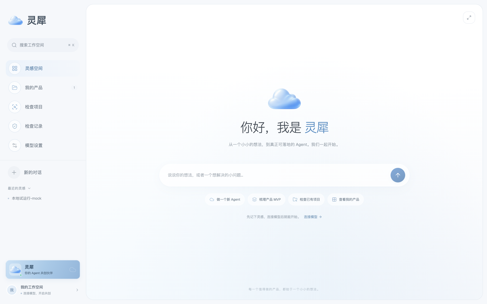

<div align="center">


# 灵犀 · Lingxi

**让灵感成形。把一个小小的想法，整理成可落地的 Agent 产品方案。**

基于 [Agent 工坊](https://github.com/hubooooooo/agent-workshop) 的本地 Agent 共创工作台，重新设计了品牌、网页界面和工作空间交互。

[](LICENSE)
[](https://www.python.org/downloads/)

[快速开始](#快速开始) · [功能](#功能) · [开发](#开发) · [上游完整文档](README.upstream.md)

</div>



## 功能

- **从想法开始**：通过对话补齐目标、用户与核心流程，整理产品需求。
- **梳理产品方案**：沿用上游引擎的 PRD、组件选型、架构推导和迭代流程。
- **管理产品**：在工作空间搜索、筛选和打开已有产品，继续之前的工作。
- **检查已有项目**：读取项目代码，生成差距报告，并保留检查记录。
- **导出交接包**：把需求、方案和相关材料交给开发者或 AI 编程工具。

灵犀这次定制的重点是网页版：蓝色渐变视觉、C4D 风格云朵 Logo、桌面与手机布局、产品列表，以及模型配置前的想法草稿保存。底层产品推导引擎与教学组件来自上游项目。

## 快速开始

需要 **Python 3.10+**，推荐 Python 3.12。仓库已包含网页构建产物，直接运行不需要 Node.js。

```bash
git clone https://github.com/buu206/lingxi.git
cd lingxi
bash setup.sh
.venv/bin/python -m blueprint ui
```

浏览器会自动打开本地界面，默认地址为 `http://127.0.0.1:8765`。也可以在 macOS 上双击 `启动界面.command`。

进入「模型设置」，配置你自己的模型服务、API Key 和模型名称后，即可开始真实对话与方案生成。尚未配置模型时，可以先保存想法；模型调用费用由所选服务商收取。

只想离线查看流程，可使用占位演示模式：

```bash
.venv/bin/python -m blueprint ui --mock
```

项目当前在本地运行；GitHub 仓库提供源码与说明，不是托管的在线 AI 服务。生成的产品资料保存在 `out/`，本机配置和运行资料不随仓库上传。

## 开发

网页源码在 `web/`，Python 服务与推导引擎在 `blueprint/`。使用 Node.js 22.12+ 构建前端：

```bash
cd web
npm ci
npm run build
```

构建结果写入 `blueprint/web/static/`；修改前端后，需要将源码和对应构建产物一起提交。

在项目根目录运行检查：

```bash
.venv/bin/python -m pytest tests -q
.venv/bin/python -m blueprint eval
```

更多引擎用法、教学模块和模型配置说明见 [上游文档](README.upstream.md) 与 [使用引导](使用引导.md)。其中的上游下载链接和原版截图对应 Agent 工坊。

## 来源与许可

本项目 Fork 自 [hubooooooo/agent-workshop](https://github.com/hubooooooo/agent-workshop)，保留原始 Git 历史和 [MIT 许可证](LICENSE)，原项目版权为 **Copyright (c) 2024 Hubo**。

灵犀定制部分由 [buu206](https://github.com/buu206) 维护，主要涉及网页产品体验与视觉设计。云朵品牌素材使用内置图像生成工具生成，[生成提示词](web/src/assets/brand/lingxi-cloud.prompt.txt) 随源码保存。
